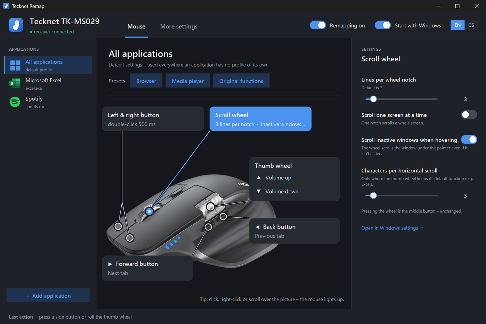
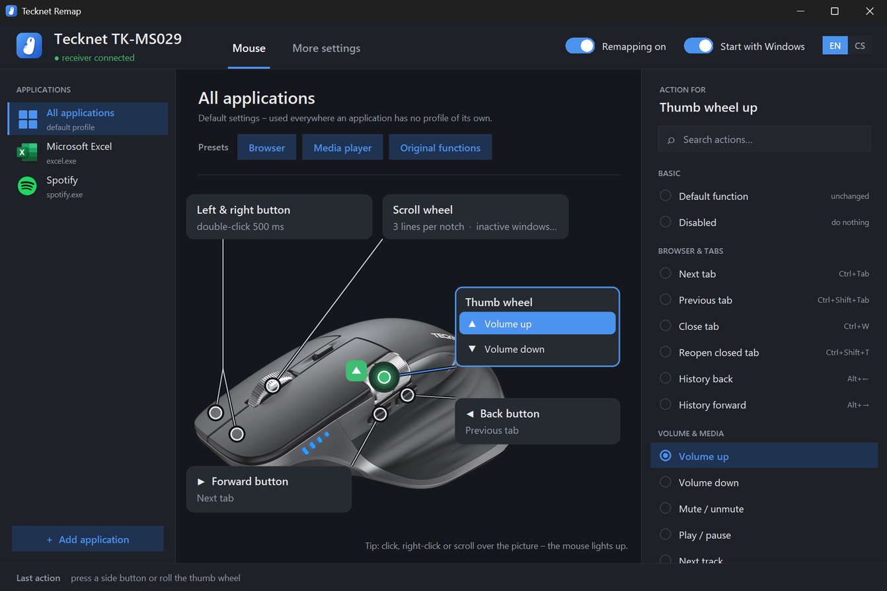
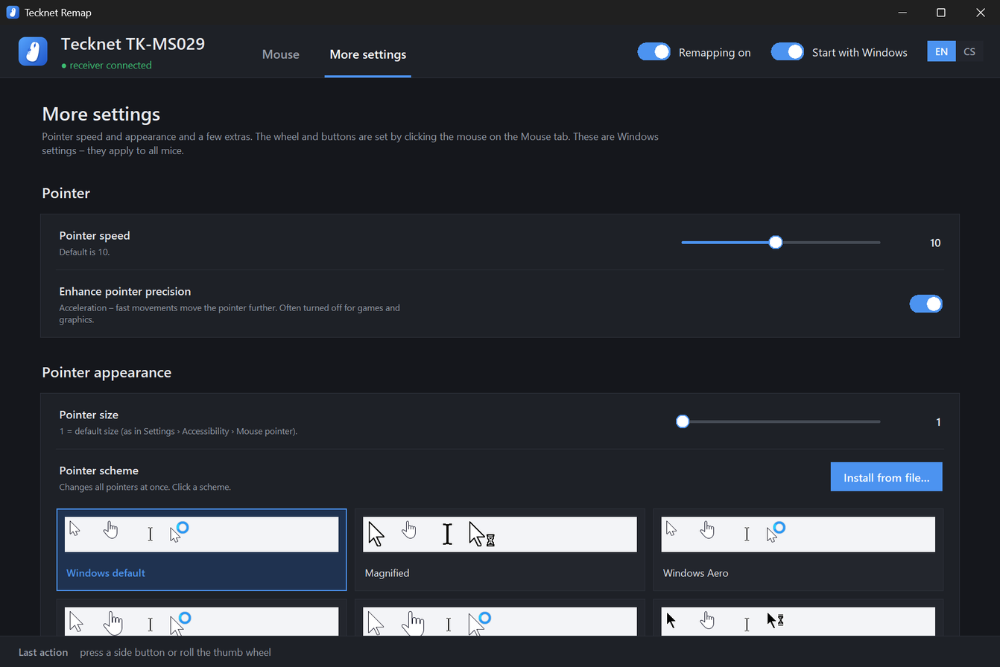

# Tecknet Remap

Unofficial settings app for the **Tecknet TK-MS029** wireless mouse on Windows. Tecknet ships no software
for this mouse, so its side buttons and thumb wheel can't be reassigned. This app adds that: remapping
per application, with a settings window in the style of Logitech Options+.

Only the Tecknet mouse is remapped. Other mice connected at the same time (a Logitech, for example) keep
working as before.



## Features

- **Remap the side buttons (Back / Forward) and the thumb wheel (up / down)**: switch browser tabs,
  change volume, control media, use editing shortcuts, switch virtual desktops, run a custom keyboard
  shortcut or start a program or file.
- **Per-application profiles**: the action depends on the window in the foreground. Profiles you don't
  edit follow the default profile, *All applications*.
- **Presets**: *Browser* (buttons switch tabs, wheel changes volume), *Media player* (buttons skip
  tracks, wheel changes volume) and *Original functions*. Media players you add (VLC, Kodi, Spotify,
  mpv…) get the *Media player* preset automatically.
- **Settings window built around a photo of the mouse**: click a control to edit it. Clicking, right-clicking
  or scrolling over the picture lights up the matching part of the mouse, so the window doubles as a
  button tester.
- **Windows mouse settings in the same window**: wheel (lines per notch, page scrolling, scrolling
  inactive windows), buttons (swap left/right, double-click speed), pointer speed and acceleration,
  pointer size and scheme, and installing pointer packs from `.zip` / `.inf` / `.cur` / `.ani` files
  (no admin rights needed).
- English and Czech interface, light and dark theme (follows Windows), tray icon, start with Windows.

Clicking the thumb wheel or a side button card opens its list of actions. Rolling the thumb wheel lights it up in the picture:



The *More settings* tab has pointer speed, pointer size and pointer schemes, including installing new pointer packs:



## Requirements

- Windows 10 or 11
- Python 3.10 or newer (developed with Python 3.15)
- [Pillow](https://pypi.org/project/pillow/): `pip install -r requirements.txt`

## Running

```
pythonw remap.pyw --show
```

The app runs as two processes:

| Command | What it is |
|---|---|
| `pythonw remap.pyw` | Background engine: mouse hook, Raw Input, tray icon. Small, no window. |
| `pythonw remap.pyw --gui` | Settings window. The engine starts it when you click the tray icon. |
| `pythonw remap.pyw --show` | Starts the engine and opens the settings window. |

Left-click the tray icon to open the settings, right-click it to pause remapping or quit.
*Start with Windows* is a switch in the window header (it writes to `HKCU\Software\Microsoft\Windows\CurrentVersion\Run`).

Older versions of the window are still available with `--v4`, `--v3`, `--v2` and `--classic`. In those
versions the engine and the window share one process.

## How it works

The TK-MS029 works through its USB receiver (`VID_25A7 PID_FA61`) or over Bluetooth (`VID 0x25A7 PID 0xFAA0`).
It sends standard events: the side buttons are XBUTTON1/XBUTTON2 and the thumb wheel is a horizontal
wheel (`WM_MOUSEHWHEEL`, ±120 per notch).

A low-level mouse hook (`WH_MOUSE_LL`) catches these events, and Raw Input tells which device sent each
one. Events from the Tecknet run the action from the active profile. Events from any other mouse are sent
on unchanged (`SendInput`).

The engine and the settings window are separate processes. Both are Python, and in one process the
window's drawing competed with the mouse hook for the interpreter lock, which made the pointer stutter.

## Configuration

Settings are saved automatically to `%APPDATA%\TecknetRemap\config.json`.

- `profiles["*"]` is *All applications*. `profiles["brave.exe"]` and so on override only what they list.
- Actions: `default`, `none`, `mouse:x1|x2|middle|hleft|hright`, `keys:ctrl+shift+t`,
  `run:C:\path\program.exe`.
- `device_match`: list of substrings of the HID device names to remap. Default:
  `VID_25A7&PID_FA61` (USB receiver) and `VID&0225A7_PID&FAA0` (Bluetooth). Another mouse that sends
  standard side-button events should work if you add its ID here.
- `debug: true` writes a log to `%APPDATA%\TecknetRemap\remap.log`.

## Known limitations

- Shortcuts can't be sent to windows running as administrator (Windows UIPI) unless the app also runs
  as administrator.
- Games that read the mouse directly through Raw Input still see the original button.
- The DPI button switches DPI inside the mouse and sends nothing to the PC, so the app can't show or
  change the DPI level.
- The volume keys always change volume by 2 % per notch.

## Assets

- `assets/app.ico`: the app icon, drawn by `tools/make_icon.py`.
- `assets/mouse.png` / `mouse_dark.png`: a cut-out of a Tecknet product photo, made with
  `tools/make_assets.py` (`python tools/make_assets.py path/to/photo.jpg`). `assets/mouse.json` holds the
  positions of the controls in that photo.

## Disclaimer

This is an unofficial project. It is not affiliated with, endorsed by or supported by Tecknet. "Tecknet"
and "TK-MS029" are trademarks of their owner. The mouse photo in `assets/` is Tecknet's product photo,
used only to illustrate which control is which. Copyright in it remains with Tecknet.
